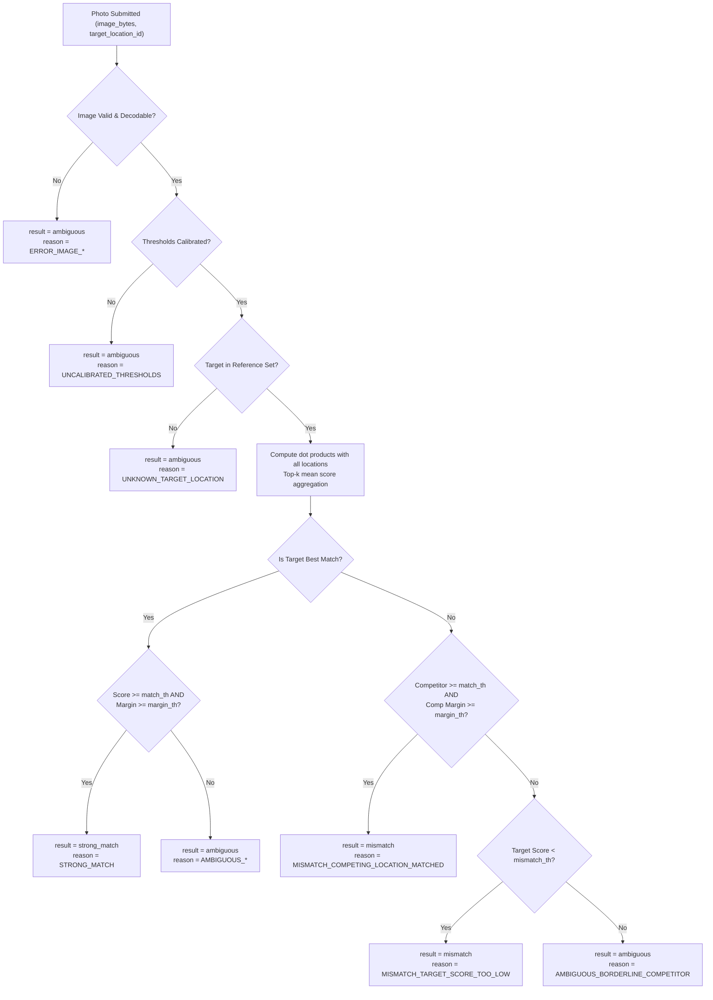

# Campus Hunt CV: AI Location-Verification Component

A robust, production-ready computer vision component for campus treasure hunts. It validates participant-submitted photos against reference imagery for campus riddle locations using OpenCLIP feature embeddings, cosine similarity, top-k aggregation, and calibrated threshold margins.

---

## 1. System Architecture & Scope

### Scope Boundary
- **Included**: Raw image byte validation, safe decoding, OpenCLIP normalized feature extraction, precomputed reference embeddings management, cosine similarity scoring with top-k aggregation, margin calculation, conservative decision logic, and empirical threshold calibration.
- **Excluded**: Web frontend, player authentication, database persistence, game progression logic, and external microservices.
- **No Location Permissions / Geofencing**: This system strictly analyzes visual content. It does **not** use GPS, geolocation coordinates, device telemetry, or QR codes.
- **Perceptual Match Only**: This component confirms whether a photo *appears to depict* a specific hunt location. It **never claims** that a photo proves physical presence or live capture (it does not detect printed photos or screens).

---

## 2. Directory Layout Contract

The pipeline expects data organized under the `data/` directory according to this exact layout:

```
data/
  reference/
    <location_id>/
      photo1.jpg
      photo2.jpg
      photo3.jpg
    library_atrium/
      ...
    science_quad/
      ...
  validation/
    <actual_location_id>/
      test_capture1.jpg
      test_capture2.jpg
    unknown/
      cafeteria.jpg
      dorm_hallway.jpg
      sidewalk.jpg
```

### Data Collection Rules:
1. **Strict Train/Val Split**: Photos in `data/validation/` must be completely independent captures. **Never** copy or leak reference images into validation.
2. **Diversity**: Reference and validation photos should be captured from multiple angles, varying distances, different smartphone cameras (iOS, Android), diverse lighting conditions (sunny, overcast, twilight), and realistic campus activity (pedestrians in background, backpacks).
3. **`unknown/` Distractors**: Contains photos of non-hunt areas (dining halls, hallways, random trees, generic doors). These are essential to calibrate the unknown-image rejection rate and prevent false acceptances of off-target photos.
4. **No Fabricated Data**: This repository provides directory scaffolding and documentation only. Embeddings and calibrated thresholds must be generated from real campus photos.

---

## 3. Installation & Setup

### Prerequisites
- Python 3.9+ (Python 3.11 recommended)
- `pip` or [`uv`](https://github.com/astral-sh/uv)

### Setup Virtual Environment

```bash
# Clone and enter directory
cd campus-hunt-cv

# Create virtual environment
python3 -m venv .venv
source .venv/bin/activate

# Install package and dependencies
pip install -r requirements.txt
pip install -e .
```

---

## 4. Running on CPU (Resource & Latency Guide)

The component is configured to run on **CPU by default**, eliminating the need for expensive GPU infrastructure or specialized cloud accelerators:

- **Model**: `ViT-B-32` pretrained on `laion2b_s34b_b79k` (~340MB weights, ~600MB peak RAM).
- **Inference Mode**: Inference runs under `torch.inference_mode()` with `model.eval()`.
- **CPU Multi-threading**: PyTorch CPU threads can be tuned via `num_threads` in `ModelConfig` or via `torch.set_num_threads(N)`. On a modern multi-core CPU (e.g. 4–8 cores), inference takes ~30–70ms per image.
- **No Vector Database Needed**: With 20–50 campus locations and 5 reference photos each (~100–250 total vectors of dimension 512), matrix dot product in NumPy takes **less than 0.2 milliseconds**. Adding an external vector database (Milvus, Pinecone, Qdrant) would add unnecessary operational overhead and network latency without any benefit at this scale.

To leverage Apple Silicon GPU acceleration if available, set `device="mps"`. For NVIDIA CUDA GPUs, set `device="cuda"`. Set `device="auto"` for automatic detection.

---

## 5. Reference Embeddings Storage Contract

Embeddings are extracted once and saved into a safe, versioned pair:
1. **Compressed NumPy Archive (`.npz`)**:
   Contains stacked unit L2-normalized float32 embeddings `(N, D)` and associated string labels `(N,)`. Loaded strictly with `allow_pickle=False` to eliminate arbitrary code execution vulnerabilities.
2. **JSON Metadata Companion (`.meta.json`)**:
   Contains schema version, model architecture name (`ViT-B-32`), weights tag (`laion2b_s34b_b79k`), feature dimension (512), timestamp, and per-location image counts and file names.

### Building Reference Embeddings

```bash
# Command to scan data/reference/ and generate embeddings
campus-hunt-build-embeddings \
  --reference-dir data/reference \
  --output-npz data/reference_embeddings.npz \
  --output-meta data/reference_embeddings.meta.json \
  --model-name ViT-B-32 \
  --pretrained laion2b_s34b_b79k \
  --device cpu
```

---

## 6. Threshold Calibration & Validation

### Why Thresholds Cannot Be Hardcoded
Cosine similarity scores depend heavily on:
- Model architecture and checkpoint embedding space geometry.
- Visual distinctiveness of campus landmarks (e.g., a gothic brick tower vs. an ultra-modern glass atrium).
- Environmental variance (direct sunlight vs. rain).

A generic threshold (e.g. `0.70`) is arbitrary and risky. Hardcoding it can lead to high false acceptance rates for distractors or false rejections of legitimate players.

### Threshold Calibration Workflow

```bash
# Evaluate labeled validation captures across a grid of thresholds and margins
campus-hunt-calibrate \
  --validation-dir data/validation \
  --embeddings-npz data/reference_embeddings.npz \
  --metadata-json data/reference_embeddings.meta.json \
  --output-config calibrated_thresholds.json \
  --max-far 0.02 \
  --device cpu
```

The script reports:
1. **Correct-Location Acceptance Rate (TAR)**: % of actual location photos verified as `strong_match`.
2. **Wrong-Location False Acceptance Rate (FAR)**: % of wrong location claims erroneously accepted as `strong_match`.
3. **Unknown-Image Rejection Rate**: % of non-hunt photos correctly rejected for all hunt locations.
4. **Per-Location Confusion Matrix**: Shows any visual confusion between similar campus spots.
5. **Calibrated Configuration Output**: Saves recommended `match_threshold` and `margin_threshold` to `calibrated_thresholds.json`.

---

## 7. Calling `verify_location` (Backend Integration)

### Security Contract: Server-Authoritative Target Location
> [!IMPORTANT]
> The caller **MUST** supply the team's current expected location from the authoritative game state on the server. **NEVER** accept or trust a client-supplied location ID submitted from a player's device.

### Verification Function

```python
from campus_hunt_cv import verify_location, LocationVerifier, CampusHuntConfig

# In a FastAPI / Flask lifespan, initialize the verifier ONCE:
config = CampusHuntConfig.from_json_file("calibrated_thresholds.json")
verifier = LocationVerifier(config=config)

# In the request handler:
result = verify_location(
    image_bytes=uploaded_file_bytes,
    target_location_id="clock_tower",  # from server game session!
    verifier=verifier,
)
```

### Return Schema

```json
{
  "result": "strong_match",
  "target_score": 0.824512,
  "best_matching_location_id": "clock_tower",
  "best_matching_score": 0.824512,
  "best_competing_location_id": "library_atrium",
  "best_competing_score": 0.612045,
  "margin": 0.212467,
  "reason_code": "STRONG_MATCH",
  "model_version": "ViT-B-32/laion2b_s34b_b79k"
}
```

### Response Fields

| Field | Type | Description |
|---|---|---|
| `result` | `"strong_match"` \| `"ambiguous"` \| `"mismatch"` | High-level verdict for game engine review. |
| `target_score` | `float` \| `null` | Cosine similarity score for expected target location. |
| `best_matching_location_id` | `str` \| `null` | Highest scoring location ID across all configured locations. |
| `best_matching_score` | `float` \| `null` | Similarity score of the top-1 location. |
| `best_competing_location_id` | `str` \| `null` | Strongest runner-up competitor (different from target). |
| `best_competing_score` | `float` \| `null` | Similarity score of the strongest competitor. |
| `margin` | `float` \| `null` | Difference: `target_score - best_competing_score`. |
| `reason_code` | `str` | Actionable machine-readable code explaining the verdict. |
| `model_version` | `str` | Model identifier (e.g. `ViT-B-32/laion2b_s34b_b79k`). |

---

## 8. Decision Logic & Conservative Safety Policy



### Decision Rules:
1. **Uncalibrated Safety Gate**: If `calibrated` is `False` or thresholds are `None`, the verifier **always** returns `"ambiguous"` with `reason_code="UNCALIBRATED_THRESHOLDS"`. It will never make up thresholds.
2. **`strong_match`**: Requires `target_location_id == best_matching_location_id` **and** `target_score >= match_threshold` **and** `margin >= margin_threshold`.
3. **`mismatch`**:
   - A competing location is a decisive match (`best_matching_score >= match_threshold` and `best_matching_score - target_score >= margin_threshold`).
   - Or `target_score < mismatch_threshold` (clearly unaligned photo).
4. **`ambiguous`**: All borderline scores, narrow margins, ties, insufficient reference photos, or uncalibrated states.
5. **Error Routing**: If image bytes are corrupted or model inference encounters an exception, the system returns `result="ambiguous"` with an `ERROR_...` reason code. The game backend can route this to manual staff review. **An AI error never turns into an unfair player failure.**

---

## 9. Score Aggregation (Top-k Mean)

For each location $L$ with $N_L$ reference photos:
1. Compute cosine similarities between the submitted photo and each reference embedding:
   $$s_i = \mathbf{q} \cdot \mathbf{r}_i \quad (i = 1, \dots, N_L)$$
2. **Standard Case ($N_L \ge k$, default $k=3$)**:
   Take the mean of the top-$k$ highest similarities:
   $$\text{score}(L) = \frac{1}{k} \sum_{j=1}^k s_{(j)}$$
3. **Safe Fallback ($0 < N_L < k$)**:
   If fewer than $k$ reference photos are available, compute the arithmetic mean across all available $N_L$ photos:
   $$\text{score}(L) = \frac{1}{N_L} \sum_{j=1}^{N_L} s_j$$
4. **Empty Case ($N_L = 0$)**:
   Score is `None`; location is flagged with `INSUFFICIENT_REFERENCE_DATA`.

---

## 10. When is Fine-Tuning Justified?

Zero-shot OpenCLIP (`ViT-B-32`) already provides rich representations of architectural landmarks, sculptures, and campus facades. **Fine-tuning on small datasets is strongly discouraged** due to the high risk of catastrophic forgetting and overfitting to specific camera models or sunny weather.

Fine-tuning is **only worth considering** if all of the following conditions are met:
1. **Data Volume**: At least **2,000 to 5,000+ labeled photos** across 30+ campus locations.
2. **Temporal & Seasonal Diversity**: Imagery captured across all four seasons, varied weather (snow, rain, overcast, intense sun), daytime, dusk, and nighttime.
3. **Device Heterogeneity**: Submissions from 50+ distinct mobile phone camera models.
4. **Empirical Need**: Pretrained ViT-B/32 achieves less than 85% correct acceptance rate at FAR $\le 2\%$, specifically due to fine-grained visual confusion between campus buildings with identical brickwork or identical doors.
5. **Methodology**: Parameter-Efficient Fine-Tuning (PEFT / LoRA on image encoder projection layers) using a supervised contrastive loss (InfoNCE) with hard negative pairs, leaving the base vision backbone frozen.

---

## 11. Testing

The test suite includes 47 fast, isolated unit tests that run completely offline without downloading model weights or requiring network access:

```bash
# Run unit tests
pytest

# Run with verbose output
pytest -v

# Run optional integration tests (downloads OpenCLIP weights)
pytest -m integration
```

